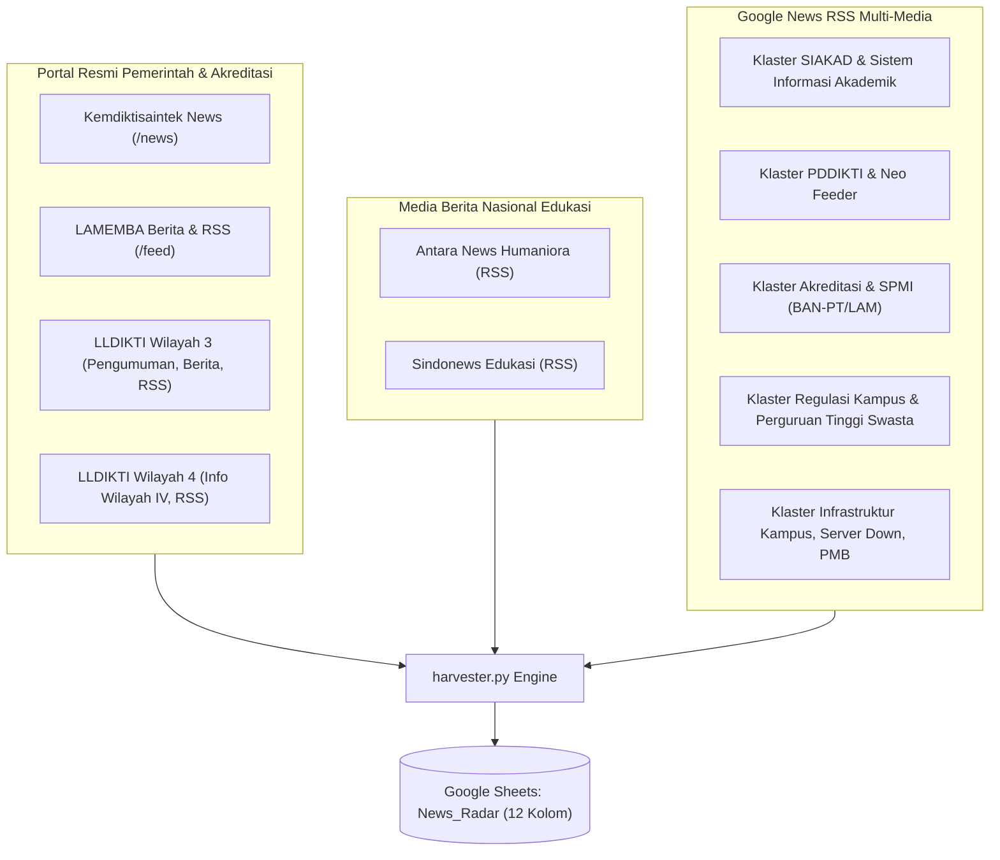
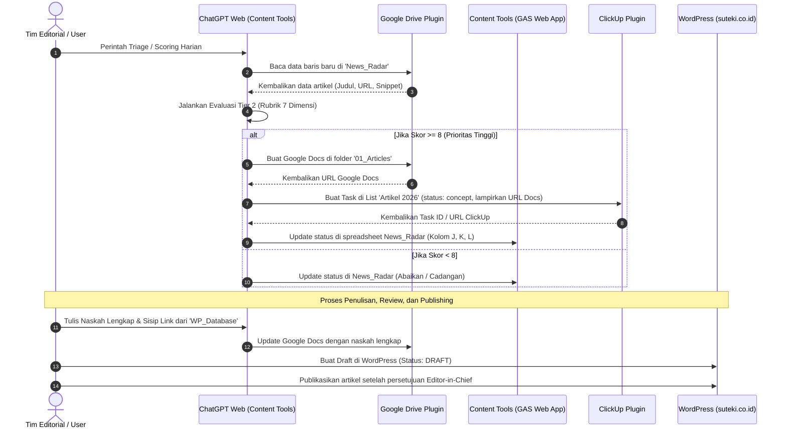

# SOP & DOKUMENTASI SISTEM: SUTEKI CONTENT ENGINE & NEWS RADAR WORKFLOW
> **Klasifikasi:** Dokumen Internal Suteki Technology  
> **Versi Dokumen:** v2.2.0 (Master Release)  
> **Target Audiens:** Content Writer, Managing Editor, SEO Specialist, Digital Marketing Lead, & Automation Maintainer  
> **Platform Penyimpanan:** ClickUp Docs (Folder: *Marketing SOP & Guidelines*)  

---

## 1. 📌 Central Resource Hub & Direktori Aset

Berikut adalah direktori seluruh tautan dan identitas sistem yang wajib disimpan (*bookmark*) oleh seluruh tim editorial dan teknis:

| Nama Aset / Sistem | Platform | URL / Identifier Resmi | Peran & Fungsi Utama | PIC Akses |
| :--- | :--- | :--- | :--- | :--- |
| **Database Suteki News Radar** | Google Sheets | [Buka Spreadsheet News Radar](https://docs.google.com/spreadsheets/d/1DRcFQZ_prGcQ3WXsFvzWCNX04K4JvJY1FiHFA5L9SwM/edit?usp=sharing) | Database hasil scraping harian, skema 12 kolom, dan tab filter per sumber media. | Editor & Bot |
| **Database Suteki News Content** | Google Sheets | [Buka Spreadsheet News Content](https://docs.google.com/spreadsheets/d/1GP3Bza7yum7MDYw1WCZp0IeNMxx6MUmMbDR63pJOsTM/edit?usp=sharing) | Bank arsip artikel WordPress eksisting (`WP_Database`) untuk riset internal linking & anchor text. | Content Writer |
| **Folder "Draft Artikel - AI"** | Google Drive | [Buka Folder Drive Draft Artikel](https://drive.google.com/drive/u/6/folders/1L_xCmlvbYhSH8MwG4TTXRcmQEx8xYv1Q) *(Folder ID: `1L_xCmlvbYhSH8MwG4TTXRcmQEx8xYv1Q`)* | Tempat penyimpanan dokumen Google Docs draft artikel baru yang digenerate otomatis. | Tim Editorial |
| **Folder Task "Artikel 2026"** | ClickUp List | [Buka List Task Clickup Artikel 2026](https://app.clickup.com/25639638/v/l/reepp-110956) *(List ID: `901612829547`)* | Kanban board manajemen task artikel, status awal `concept`, assignee default: Vika. | Tim Konten |
| **Repositori Harvester** | GitHub | [GitHub: crawler-news-kampus](https://github.com/mochramdani3395/crawler-news-kampus) | Repositori bot Python & GitHub Actions automation (cron 06:00 WIB). | Tech Maintainer |
| **Website Portal Publik** | WordPress | `https://suteki.co.id` | CMS tujuan penerbitan akhir artikel blog Suteki Technology. | Editor in Chief |

---

## 2. 🎯 Latar Belakang, Problem Statement, & Nilai Bisnis

### 2.1 Problem Statement (Kelemahan Alur Lama)
Sebelum pipeline ini dibangun, proses riset hingga penulisan artikel menghadapi kendala mendasar:
1. **Inefisiensi Riset:** Riset berita manual menghabiskan 1–2 jam setiap pagi per penulis tanpa kepastian menemukan isu yang relevan dengan bisnis.
2. **Kendala Crawler Lama:** Sistem crawler terdahulu (*deep spidering*) sering mengalami *timeout* atau pemblokiran karena membebani server perguruan tinggi yang lambat.
3. **Keterlambatan Momentum:** Informasi regulasi mendesak (Kemdiktisaintek, LLDIKTI, BAN-PT/LAM) sering terlambat direspons dibanding kompetitor.
4. **Disiplin SEO & Internal Linking Terfragmentasi:** Penulis kesulitan mencari artikel lama untuk disisipkan sebagai *hyperlink* ("Baca Juga"), sehingga struktur *topical authority* di Google kurang optimal.

### 2.2 Transformasi Alur Kerja (Old vs New)

```text
[ ALUR LAMA ]
Riset Manual Portal Web ──> Draf di Word Lokal ──> Copy ke Trello/WA ──> Upload Manual ke WP
(Lambat, rentan tertinggal isu regulasi, tanpa tracking internal linking)

[ ALUR BARU TERPADU ]
GitHub Harvester (06:00 WIB) ──> Google Sheets (News_Radar) ──> AI Tier 1 (Gemini)
                                                                       │
┌──────────────────────────────────────────────────────────────────────┘
▼
ChatGPT Web / Content Tools GAS ──> Buat Google Docs di Drive & Buat Task ClickUp [concept]
                                        │
                                        ▼
Penulis Mengembangkan Draf + Sisip Internal Link (dari Database News Content)
                                        │
                                        ▼
Editor Review & Yoast SEO QA ──> Transfer Draft ke WordPress (suteki.co.id)
```

### 2.3 Nilai Bisnis bagi Suteki Technology
Suteki Technology memposisikan diri bukan sekadar vendor aplikasi, melainkan **mitra strategis transformasi digital kampus**. Dengan alur baru ini:
- **Respon Cepat Regulasi:** Suteki menerbitkan panduan solutif dalam hitungan jam setelah surat edaran Kemdiktisaintek/LLDIKTI dirilis.
- **Topical Authority:** Memperkuat posisi SEO Suteki di ranah **SIAKAD Cloud**, **Neo Feeder PDDIKTI**, **Akreditasi BAN-PT/LAM (LAMEMBA, LAM-INFOKOM, LAMDIK)**, dan **SPMI**.

---

## 3. 🌐 Daftar Lengkap Sumber Scraping (Ingestion Pipeline)

Bot `harvester.py` mengeksekusi penarikan artikel baru setiap hari pukul **06:00 WIB** melalui 3 klaster sumber data:



### Rincian Endpoint Sumber:
1. **Kemdiktisaintek News**: `https://kemdiktisaintek.go.id/news` (Direct HTML Scraper link `/news/article/...`).
2. **LAMEMBA (Ekonomi, Manajemen, Bisnis, Akuntansi)**:
   - Web Berita: `https://lamemba.or.id/berita/`
   - RSS Feed: `https://lamemba.or.id/feed/`
3. **LLDIKTI Wilayah 3 (Jakarta)**:
   - Pengumuman: `https://lldikti3.kemdiktisaintek.go.id/pengumuman/` (Surat edaran, BKD)
   - Berita LLDIKTI: `https://lldikti3.kemdiktisaintek.go.id/berita-lldikti/` (Tracer study, mutu, SINTA)
   - Berita Perguruan Tinggi: `https://lldikti3.kemdiktisaintek.go.id/berita-perguruan-tinggi/` (PTS binaan)
   - RSS Feed: `https://lldikti3.kemdiktisaintek.go.id/feed/`
4. **LLDIKTI Wilayah 4 (Jawa Barat & Banten)**:
   - Info Wilayah IV: `https://lldikti4.kemdiktisaintek.go.id/info-lldikti-wilayah-iv/` (Pelaporan PDDIKTI, LAMSAMA)
   - RSS Feed: `https://lldikti4.kemdiktisaintek.go.id/feed/`
5. **Media Nasional Edukasi**:
   - Antara News: `https://www.antaranews.com/rss/humaniora.xml`
   - Sindonews: `https://edukasi.sindonews.com/rss`
6. **Google News Search Feed**: Menjaring media nasional (Kompas, Detik, Tempo, Republika, Media Indonesia, SEVIMA, dll.) berbasis kueri presisi.

---

## 4. ⚖️ Metodologi & Standar Penilaian Scoring (Dua Tahap)

Sistem menggunakan arsitektur **Two-Tier AI Scoring** untuk memisahkan filter kasar otomatis dari penilaian strategis editorial manusia/ahli:

```text
[ ARTIKEL MASUK DARI CRAWLER ]
             │
             ▼
┌────────────────────────────────────────┐
│  TIER 1: Bot Automated Triage (Gemini) │ ──> Skala 1 - 10
└────────────────────────────────────────┘     (Prioritas tinggi: Skor 8 - 10)
             │
             ▼
┌────────────────────────────────────────┐
│  TIER 2: Deep Editorial Scoring        │ ──> Rubrik 7 Dimensi (0 - 100)
│  (Content Tools GAS / ChatGPT Web)     │     + Quality Gate Filters
└────────────────────────────────────────┘
             │
             ▼
[ P1 / Skor >= 8 ] ──> Otomasi Google Docs & Task ClickUp 'concept'
```

### 4.1 Tier 1: Bot Automated Triage (Skala 1–10)
Dijalankan secara otomatis oleh model **Gemini Free Tier** di GitHub Actions saat crawler berjalan:
- **Skor 8–10 (Tinggi/Prioritas):** Berita langsung menyangkut SIAKAD, server kampus down saat KRS/PMB, surat edaran resmi Kemdiktisaintek/LLDIKTI, regulasi baru PDDIKTI/Neo Feeder/BKD, akreditasi kampus (BAN-PT/LAM), atau SPMI.
- **Skor 5–7 (Menengah):** Isu pendidikan tinggi umum, UKT/biaya kuliah, SNPMB/PMB reguler, AI dalam pembelajaran, atau kegiatan perguruan tinggi umum.
- **Skor 1–4 (Rendah/Abaikan):** Berita seremonial wisuda, kriminal/tawuran kampus, kejuaraan olahraga, atau berita sekolah dasar/menengah.

### 4.2 Tier 2: Deep Editorial Scoring (Rubrik 0–100 dalam 7 Dimensi)
Dijalankan oleh editor manusia atau diorkestrasi oleh **Content Tools (GAS)** di ChatGPT Web:

$$\text{Total Skor} = D_1(25) + D_2(20) + D_3(15) + D_4(15) + D_5(10) + D_6(10) + D_7(5)$$

| No | Dimensi Penilaian | Poin Maks | Panduan Pemberian Poin |
| :---: | :--- | :---: | :--- |
| **D1** | **Kesesuaian Audiens & Bisnis Suteki** | **25** | 0–5: Di luar perguruan tinggi.<br>6–14: Terkait kampus tapi bukan ranah software.<br>15–20: Kebutuhan operasional kampus umum.<br>21–25: Terkait langsung SIAKAD, PDDIKTI, Akreditasi/SPMI, PMB, Keuangan. |
| **D2** | **Nilai Praktis bagi Pembaca** | **20** | 0–4: Seremonial murni.<br>5–10: Informasi umum.<br>11–15: Ada implikasi/pembelajaran penting.<br>16–20: Menghasilkan checklist/SOP/keputusan penting bagi pimpinan kampus. |
| **D3** | **Potensi SEO & Search Intent** | **15** | 0–3: Tanpa intent pencarian.<br>4–8: Kueri pencarian terbatas.<br>9–12: Kueri jelas dicari target pembaca.<br>13–15: Volume tinggi, dapat dijawab jauh lebih mendalam dibanding kompetitor. |
| **D4** | **Kredibilitas & Sumber Primer** | **15** | 0–3: Rumor/klaim tak terlacak.<br>4–7: Agregator/kutipan sekunder.<br>8–11: Media nasional terpercaya.<br>12–15: Dokumen resmi kementerian, surat edaran LLDIKTI, instrumen BAN-PT/LAM. |
| **D5** | **Aktualitas / Nilai Evergreen** | **10** | 0–2: Sudah usang.<br>3–5: Sebagian relevan.<br>6–8: Masih hangat (minggu ini).<br>9–10: Breaking news regulasi mendesak ATAU evergreen fundamental. |
| **D6** | **Keunikan Angle / Content Gap** | **10** | 0–2: Sudut pandang klise/generik.<br>3–5: Perbedaan minim.<br>6–8: Sudut pandang solutif khas Suteki.<br>9–10: Mengisi kekosongan informasi yang belum dibahas media lain. |
| **D7** | **Kesesuaian Strategi Editorial Suteki** | **5** | 0: Di luar fokus.<br>1–2: Pendukung periferal.<br>3–4: Memperkuat otoritas topik pilar.<br>5: Langsung mendukung prioritas kampanye produk aktif Suteki. |

### 4.3 Peringkat Prioritas & Quality Gates
- **P1 (85–100) — Riset Segera:** Masuk antrean prioritas pembuatan konsep dan task ClickUp.
- **P2 (70–84) — Backlog SEO:** Disimpan untuk jadwal penulisan bertahap.
- **P3 (50–69) — Butuh Angle Baru:** Hanya ditulis jika ditemukan sudut pandang baru yang unik.
- **P4 (0–49) — Arsip/Abaikan:** Tidak diproduksi menjadi artikel.

> [!IMPORTANT]
> **Quality Gate Filters (Penahan Otomatis):**  
> Artikel dengan skor tinggi **tetap dilarang ditulis** jika terkena penahan berikut:
> - `HOLD_VERIFY`: Surat edaran/dokumen regulasi belum terverifikasi keasliannya.
> - `HOLD_DUPLICATE`: Sudah ada artikel dengan pembahasan identik di blog Suteki.
> - `HOLD_SCOPE`: Di luar ranah pendidikan tinggi (misal: istilah SPMI yang bukan penjaminan mutu).
> - `HOLD_PRODUCT`: Sudut pandang memaksakan klaim fitur produk yang belum ada di Suteki.

---

## 5. 🧠 Anatomi & Spesifikasi Skill `suteki-content-engine`

Skill `suteki-content-engine` adalah *mindset* dan standar editorial inti yang diterapkan saat menyusun artikel Suteki:

### 5.1 Identitas & Suara Tulisan
Penulis bertindak sebagai **Konsultan Ahli Transformasi Digital Kampus sekaligus Penulis SEO Profesional**:
- **Tone of Voice:** Otoritatif, berbasis data/fakta, solutif, empatik terhadap beban birokrasi kampus, dan jelas.
- **Bukan Hard-Selling:** Suteki tidak menjual software dengan memaksakan iklan; Suteki menjelaskan akar masalah tata kelola kampus dan menunjukkan bagaimana teknologi menyelesaikan masalah tersebut.

### 5.2 Target Persona Pembaca Kampus
Setiap artikel harus dirancang untuk menjawab keresahan spesifik persona berikut:
1. **Rektor / Wakil Rektor:** Reputasi kampus, kepatuhan regulasi, efisiensi anggaran, pencapaian akreditasi Unggul.
2. **Kepala BAAK / Biro Akademik:** Kelancaran KRS, validitas transkrip, antrean mahasiswa, beban operasional staf.
3. **Ketua LPM / LP3M (Penjaminan Mutu):** Siklus PPEPP, kesiapan borang akreditasi BAN-PT/LAM, kepatuhan SPMI.
4. **Operator PDDIKTI:** Validitas data pelaporan 100%, sinkronisasi Neo Feeder tanpa error, batas waktu checkpoint.
5. **Kepala UPT IT / Puskom:** Keandalan server, keamanan data, arsitektur cloud, integrasi API sistem kampus.

### 5.3 Dua Pintu Masuk Penulisan (Dual Ingestion Route)
1. **Rute `TOPIC_DIRECT`:** Penugasan topik mandiri langsung dari strategi pemasaran (contoh: *"Mengapa SIAKAD Terintegrasi Penting untuk Akreditasi 2027"*). Tidak memerlukan skor News Radar.
2. **Rute `NEWS_RADAR`:** Pengolahan berita hasil crawling yang lolos kurasi skor P1/P2. Berita dijadikan *pemicu isu*, bukan sekadar dirangkum ulang.

### 5.4 Standar Tampilan Dokumen Native Google Docs
- Judul utama berformat **Heading 1 (H1)**.
- Subbab utama berformat **Heading 2 (H2)** dan sub-poin berformat **Heading 3 (H3)**.
- Penekanan kata kunci menggunakan **Bold Native** secara proporsional.
- Referensi dokumen resmi di akhir artikel memuat nama lembaga, nomor surat/peraturan, dan **hyperlink aktif**.
- **Aturan Blok "Baca juga:":**
  > [!WARNING]
  > Blok *"Baca juga:"* **DILARANG KERAS** menggunakan format H2 atau H3.  
  > Format wajib: Teks paragraf biasa (**`NORMAL_TEXT`**), di mana label "Baca juga:" di-*bold*, dan judul artikel ditautkan dengan *hyperlink*.  
  > *Contoh:* **Baca juga:** [Panduan Lengkap Pelaporan Neo Feeder PDDIKTI 100% Valid](https://suteki.co.id/...)

### 5.5 Tingkat Integrasi Produk (*Product Bridging*)
- **`none`:** Artikel edukasi/regulasi murni tanpa menyebut produk Suteki.
- **`light`:** Menyebutkan konsep solusi sistem modern secara umum.
- **`soft`:** Menyebutkan fitur relevan Suteki sebagai salah satu contoh *best practice* di bagian akhir.
- **`direct`:** Artikel *problem-solution* di mana SIAKAD Cloud atau Neo Feeder Suteki dibahas sebagai solusi utama masalah yang diangkat.

---

## 6. 🔌 Arsitektur Integrasi Multi-Platform

Alur ini mengintegrasikan **ChatGPT Web** sebagai otak orkestrasi dengan **Google Drive**, **ClickUp**, **Google Apps Script (GAS)**, dan **WordPress**:



### Konfigurasi Endpoint & Identifier Sistem:
- **ClickUp API Target:**
  - Workspace ID: `25639638`
  - Space Marketing ID: `60779000`
  - Folder Artikel ID: `90031180059`
  - Target List: `Artikel 2026` (List ID: `901612829547`)
  - Assignee Default: Vika (`66620511`)
  - Status Awal: `concept`
- **Google Drive API Target:**
  - Folder Penampung Draft AI: `01_Articles` (Folder ID: `1L_xCmlvbYhSH8MwG4TTXRcmQEx8xYv1Q`)
- **WordPress Target:**
  - Endpoint: `https://suteki.co.id/wp-json/wp/v2/posts`
  - Status Standar Pembuatan: `draft` *(Dilarang otomatis `publish`)*

---

### 6.2 State Machine & Trigger Status Otomatis ClickUp

Perubahan status pada kartu task ClickUp memicu tindakan sistem dan perpindahan tanggung jawab sebagai berikut:

```text
[ concept ] ──> Dibuat otomatis oleh GAS/ChatGPT (memuat URL Google Docs & Skor Radar)
     │
     ▼
[ ready to write ] ──> Editor menugaskan Writer & menetapkan Due Date / Target Publish
     │
     ▼
[ drafting ] ──> Penulis menyusun naskah di Google Docs & riset internal link
     │
     ▼
[ ready for review ] ──> (TRIGGER 1) Notifikasi otomatis ke Editor: Fact-Check & SEO QA
     │
     ▼
[ editor_approved ] ──> (TRIGGER 2) GAS memicu pembuatan DRAFT di WordPress via REST API.
     │                   Link preview WP disematkan balik ke deskripsi task ClickUp!
     ▼
[ scheduled ] ──> (TRIGGER 3) Parameter tanggal & jam rilis di-set di WordPress (status 'future')
     │
     ▼
[ published ] ──> (TRIGGER 4) Artikel live di suteki.co.id!
                  - URL live dicatat otomatis ke 'Database Suteki News Content' (WP_Database).
                  - Kolom L di Sheet 'News_Radar' diupdate: 'Published: [URL]'.
                  - Task ClickUp ditutup (Complete).
```

---

### 6.3 Mekanisme Sinkronisasi Dua Arah & Penanganan Perubahan (Bidirectional Sync)

Untuk mencegah terjadinya *desync* data atau duplikasi task saat terjadi perubahan di salah satu platform:

#### A. Jika Terjadi Perubahan dari Sisi WordPress:
1. **Perubahan Status (Draft $\rightarrow$ Published / Scheduled):**
   - Webhook WordPress / script sinkronisasi memetakan `wp_post_id` atau `content_id` yang tersimpan pada custom fields.
   - Status task di ClickUp otomatis bergeser dari `editor_approved` menjadi `published` atau `scheduled`.
   - URL publik yang resmi aktif otomatis disalin ke kolom deskripsi ClickUp dan ditambahkan ke baris baru spreadsheet `Database Suteki News Content` (`WP_Database`) agar penulis lain langsung dapat menjadikannya referensi internal link.
2. **Perubahan Judul / Slug / Featured Image:**
   - Jika editor memperbarui slug atau gambar sampul langsung di WordPress, metadata pada task ClickUp diperbarui otomatis tanpa menimpa naskah di Google Docs yang menjadi arsip sejarah penulisan.

#### B. Jika Terjadi Perubahan dari Sisi Aplikasi Content Tools - GAS:
1. **Prinsip Idempotensi Berbasis `content_id`:**
   - Setiap artikel memiliki identitas permanen (contoh: `SUT-2026-RADAR-000591-IAPS-LAMSAMA`).
   - Jika pengguna melakukan *re-scoring*, mengganti angle, atau memperbarui outline melalui Content Tools GAS, sistem **wajib mencari artefak eksisting terlebih dahulu**:
     * Cari apakah task ClickUp dengan `content_id` tersebut sudah ada.
     * Jika sudah ada: Lakukan **UPDATE** pada judul task, deskripsi, dan isi Google Docs.
     * **DILARANG KERAS** membuat task ClickUp baru atau dokumen Google Docs baru untuk artikel yang sama agar tidak terjadi *task bloating* dan penumpukan file duplikat di Google Drive.
2. **Penanganan Kegagalan Parsial (Partial Success Recovery):**
   - Jika Google Docs berhasil dibuat namun pembuatan task ClickUp gagal (misal karena rate-limit API), sistem mencatat status `PARTIAL_SUCCESS` beserta `google_doc_id`.
   - Saat proses dijalankan ulang (*retry*), sistem langsung melanjutkan pembuatan task ClickUp dengan menautkan Docs yang sudah ada, tanpa membuat dokumen baru.

---

### 6.4 Kebijakan & Alur Penjadwalan Post (Schedule Post & Editorial Calendar)

Penetapan jadwal tayang (*schedule post*) diatur berdasarkan klasifikasi urgensi artikel:

#### 1. Klasifikasi Prioritas Penjadwalan:
* **Jalur Ekspres (Breaking News & Regulasi Mendesak):**
  - Kriteria: Surat edaran kementerian, deadline pelaporan Neo Feeder PDDIKTI, instrumen baru LAM/BAN-PT, atau server kampus nasional down.
  - Target Jadwal: **Same-Day** atau maksimal **H+1** pada jam aktif operasional kampus (pukul 09:00 atau 13:00 WIB) untuk menangkap volume pencarian yang sedang memuncak.
* **Jalur Reguler (Evergreen Education & Thought Leadership):**
  - Kriteria: Panduan tata kelola SPMI, tips peningkatan akreditasi prodi, efisiensi PMB, arsitektur cloud kampus.
  - Target Jadwal: Mengikuti kalender editorial mingguan (Slot teratur: **Selasa, Kamis, dan Sabtu pukul 10:00 WIB**).

#### 2. Alur Teknis Penjadwalan (*Drafting to Scheduled*):
1. **Penetapan Tanggal di ClickUp:** Editor menetapkan tanggal dan jam rilis pada Custom Field **`Publish Date`** atau **`Due Date`** di task ClickUp.
2. **Sinkronisasi ke WordPress via GAS:**
   - Ketika status ClickUp diubah ke `scheduled`, GAS mengirim request ke WordPress REST API:
     ```json
     {
       "status": "future",
       "date": "2026-11-12T10:00:00",
       "date_gmt": "2026-11-12T03:00:00"
     }
     ```
   - WordPress secara native akan mengantrekan postingan tersebut untuk terbit secara otomatis sesuai jadwal waktu Indonesia Barat (WIB).
3. **Quality & Security Gate (Pencegah Salah Terbit):**
   - Artikel baru **WAJIB dibuat dengan status `draft` terlebih dahulu** di WordPress.
   - Status artikel hanya boleh diubah menjadi `future` (terjadwal) atau `publish` setelah naskah lolos verifikasi akhir dan memperoleh persetujuan eksplisit (*publication approval*) dari Managing Editor. Dilarang keras melakukan publish otomatis langsung dari bot.

---

### 6.5 Mekanisme Ekstraksi & Injeksi SEO Metadata (AI vs Google Apps Script)

Bagian ini menjelaskan secara rinci pembagian peran antara AI dan Google Apps Script (GAS) dalam menghasilkan dan menyuntikkan metadata SEO serta teks alternatif gambar (*Alt Text*):

#### A. Pembagian Peran: AI vs Google Apps Script
* **Peran AI (ChatGPT Web): Generator Konten SEO**
  - AI bertugas merumuskan seluruh konten metadata SEO sesuai standar Yoast:
    1. **Focus Keyword / Focus Keyphrase**: Kata kunci pencarian target (contoh: *SIAKAD Cloud Perguruan Tinggi*).
    2. **Meta Title (SEO Title)**: Judul SEO ramah klik maksimal 60 karakter.
    3. **Meta Description**: Ringkasan artikel informatif antara 120–155 karakter.
    4. **Image Alt Text & Caption**: Teks deskriptif aksesibilitas gambar.
  - AI menuliskan data ini secara terstruktur ke dalam **Deskripsi Task ClickUp** (dan tabel sampul Google Docs) pada saat inisiasi konsep awal.
* **Peran Google Apps Script (GAS): Engine Parser & API Injector**
  - GAS bertindak sebagai *jembatan teknis* (mekanis). GAS **tidak mengarang** teks SEO.
  - GAS membaca teks deskripsi task ClickUp menggunakan *Regular Expression (Regex)* presisi melalui fungsi `parseClickUpTaskMetadata_()`.
  - GAS kemudian menyuntikkan data tersebut secara programatik melalui **WordPress REST API**.

#### B. Struktur Format Khusus yang Dibaca oleh GAS (Regex Parsing)
Agar script GAS (`src/ClickUp.js`) dapat mengekstrak metadata SEO secara otomatis dari deskripsi task ClickUp, AI wajib menuliskan format deskripsi dengan pola berikut:

```markdown
### 🎯 SEO Yoast Specs:
- **Focus Keyword**: SIAKAD Cloud Perguruan Tinggi
- **Meta Title**: Mengapa SIAKAD Cloud Penting untuk Akreditasi Kampus 2027?
- **Meta Description**: Pelajari pentingnya SIAKAD Cloud dalam menghadapi instrumen akreditasi kampus terbaru agar pelaporan Neo Feeder 100% valid dan bebas kendala server.
- **Kategori**: SIAKAD & Sistem Informasi

### 🖼️ Image SEO (Cover):
- **Alt Text**: SIAKAD Cloud Perguruan Tinggi - Panduan Akreditasi Kampus
- **Caption Gambar**: Ilustrasi transformasi digital sistem informasi akademik kampus
```

* **Pola Regex Pembacaan di Kode GAS (`src/ClickUp.js:823-928`):**
  - *Focus Keyword:* `/(?:Focus Keyword|Kata Kunci Fokus|Focus Keyphrase|Keyword)\s*[:\*]\s*([^\n\r<]+)/i`
  - *Meta Title:* `/(?:Meta Title|SEO Title|Judul SEO)\s*[:\*]\s*([^\n\r<]+)/i`
  - *Meta Description:* `/(?:Meta Description|Deskripsi Meta|Meta Desc)\s*[:\*]\s*([^\n\r<]+)/i`
  - *Kategori:* `/(?:Kategori|Category)\s*[:\*]\s*([^\n\r<]+)/i`
  - *Image Alt Text:* `/(?:Image Alt|Alt Text|Alt Gambar|Cover Alt)\s*[:\*]\s*([^\n\r<]+)/i`

> [!TIP]
> **Fitur Smart SEO Fallback (Yoast 100% Green Score):**  
> Jika desainer atau penulis lupa mengisi `Alt Text` di deskripsi task, script GAS secara otomatis mengombinasikan:
> ```javascript
> imageAlt = `${focusKeyword} - ${taskName}`;
> ```
> Langkah otomatis ini menjamin audit indikator Yoast SEO **"Keyphrase in Image Alt Attributes"** langsung bernilai **HIJAU** tanpa perlu intervensi manual!

#### C. Proses Injeksi Teknis ke WordPress REST API
Ketika status task diubah menjadi `in Review` atau `Ready`:
1. **Injeksi Alt Text ke Media Library (`src/WordPress.js:89-132`):**
   GAS mengunggah cover artikel ke endpoint `/wp-json/wp/v2/media/{id}` dan menyuntikkan objek metadata gambar:
   ```json
   {
     "alt_text": "SIAKAD Cloud Perguruan Tinggi - Panduan Akreditasi Kampus",
     "caption": "Ilustrasi transformasi digital sistem informasi akademik kampus",
     "description": "Ilustrasi transformasi digital sistem informasi akademik kampus"
   }
   ```
2. **Injeksi Field Meta Yoast ke Post Draft (`src/WordPress.js:159-175`):**
   GAS membuat atau memperbarui postingan artikel di `/wp-json/wp/v2/posts/{id}` dengan field custom meta Yoast SEO:
   ```json
   {
     "title": "Mengapa SIAKAD Cloud Penting untuk Akreditasi Kampus 2027?",
     "content": "<html>...isi artikel lengkap dari Google Docs...</html>",
     "status": "draft",
     "featured_media": 12458,
     "meta": {
       "_yoast_wpseo_title": "Mengapa SIAKAD Cloud Penting untuk Akreditasi Kampus 2027?",
       "_yoast_wpseo_metadesc": "Pelajari pentingnya SIAKAD Cloud dalam menghadapi instrumen akreditasi kampus terbaru...",
       "_yoast_wpseo_focuskw": "SIAKAD Cloud Perguruan Tinggi"
     }
   }
   ```
Dengan metode ini, begitu editor membuka dashboard WordPress di `wp-admin/post.php?post={id}&action=edit`, seluruh kotak isian Yoast SEO (fokus kata kunci, judul SEO, deskripsi meta, dan alt text gambar) **sudah terisi otomatis dan siap di-preview**.

---

## 7. 🔄 Standard Operating Procedure (SOP) Alur Kerja End-to-End

Berikut adalah tahapan operasional harian tim editorial Suteki:

```text
[ 06:00 WIB ] Bot Harvester jalan otomatis via GitHub Actions
      │
[ 08:30 WIB ] Editor membuka Sheet 'News_Radar', filter skor >= 8
      │
[ 09:00 WIB ] Jalankan Prompt Konsep di ChatGPT Web (Content Tools GAS)
      │       ├── Dokumen Google Docs terbuat otomatis di Drive
      │       └── Task ClickUp berstatus 'concept' terbuat di List 2026
      │
[ 10:00 WIB ] Penulis membuka task ClickUp & Google Docs
      │       ├── Riset internal linking di 'Database Suteki News Content'
      │       └── Tulis artikel lengkap sesuai pedoman suteki-content-engine
      │
[ 14:00 WIB ] Editor melakukan Review Faktual & Yoast SEO QA
      │
[ 16:00 WIB ] Artikel dipindahkan ke Draft WordPress & dijadwalkan tayang
```

### Checklist Tindakan Tim:
- [ ] **Langkah 1 (Sistem - 06:00 WIB):** Bot crawler menarik artikel dan mengisi sheet `News_Radar`.
- [ ] **Langkah 2 (Editor - 08:30 WIB):** Periksa tab khusus (`Kemdiktisaintek`, `LLDIKTI 3`, `LAMEMBA`). Pilih artikel dengan Skor Awal $\ge$ 8.
- [ ] **Langkah 3 (Editor/GAS - 09:00 WIB):** Picu pembuatan konsep di ChatGPT Web. Pastikan file Google Docs muncul di folder `Draft Artikel - AI` dan task muncul di ClickUp dengan status `concept`.
- [ ] **Langkah 4 (Writer - 10:00 WIB):** 
  - Ubah status ClickUp dari `concept` menjadi `drafting`.
  - Buka sheet `Database Suteki News Content`, pilih 2–3 artikel terkait.
  - Tulis artikel lengkap di Google Docs (minimal 1000–1500 kata untuk topik pilar).
  - Sisipkan blok *"Baca juga:"* dan *contextual link*.
- [ ] **Langkah 5 (Editor - 14:00 WIB):**
  - Verifikasi kebenaran nomor surat edaran/peraturan.
  - Cek skor Yoast SEO (fokus keyphrase, meta title $\le$ 60 karakter, meta description 120–155 karakter).
  - Ubah status ClickUp menjadi `ready for review` $\rightarrow$ `editor_approved`.
- [ ] **Langkah 6 (Publishing - 16:00 WIB):**
  - Pindahkan isi artikel ke CMS WordPress (`suteki.co.id`) dalam status **Draft**.
  - Masukkan featured image, kategori, dan tag relevan.
  - Publish artikel dan ubah status ClickUp menjadi `published`.

---

## 8. 🔗 Panduan SEO & Strategi Internal Linking (Database Suteki News Content)

*Internal linking* yang terstruktur adalah kunci utama mendominasi kata kunci industri edtech kampus di mesin pencari.

### 8.1 Cara Menggunakan Spreadsheet `Database Suteki News Content`
1. Buka spreadsheet [Database Suteki News Content](https://docs.google.com/spreadsheets/d/1GP3Bza7yum7MDYw1WCZp0IeNMxx6MUmMbDR63pJOsTM/edit?usp=sharing).
2. Gunakan fitur *Search / Filter* (`Ctrl + F`) untuk mencari topik artikel baru Anda (contoh kata kunci: *SIAKAD, Akreditasi, Neo Feeder, SPMI, PMB*).
3. Pilih artikel yang memiliki status `publish` dan memiliki relevansi konteks yang erat.

### 8.2 Aturan Penempatan Tautan (Linking Rules)
Setiap artikel baru wajib memiliki **minimal 2–3 internal link**:
1. **Contextual Hyperlink (Minimal 1–2 tautan):** Tautan yang diletakkan langsung di dalam kalimat pada kata kunci deskriptif (*anchor text*).
   - *Benar:* "...perguruan tinggi wajib mengintegrasikan [sistem informasi akademik berbasis cloud](https://suteki.co.id/...) untuk menghindari kendala server saat KRS..."
   - *Salah (Dilarang):* "...klik [di sini](https://suteki.co.id/...) untuk membaca tentang SIAKAD."
2. **Blok "Baca juga:" (Minimal 1 tautan):**
   - Wajib berformat **`NORMAL_TEXT`** (bukan heading).
   - Label di-bold, judul artikel ber-hyperlink.
   - Diletakkan di bawah subbab H2 yang relevan.

### 8.3 Strategi Outgoing vs Incoming Links
- **Outgoing Link:** Tautan dari artikel baru yang sedang ditulis mengarah ke artikel lama Suteki.
- **Incoming Link (Penting):** Setelah artikel baru terbit di `suteki.co.id`, buka 1–2 artikel lama yang relevan di WordPress, lalu edit naskah artikel lama tersebut untuk menautkan balik ke URL artikel baru yang baru saja tayang. Ini memberi sinyal kuat kepada Google bahwa artikel baru tersebut penting.

---

## 9. 🛠️ Panduan Pemeliharaan Teknis GitHub & Google Sheets

### 9.1 Komponen Repositori GitHub (`crawler-news-kampus`)
- `harvester.py`: Script Python utama yang mengelola scraping, RSS parsing, Gemini AI scoring triage, integrasi Google Sheets (`gspread`), dan pembuatan tab per sumber.
- `.github/workflows/main.yml`: Skrip orkestrasi GitHub Actions yang berjalan otomatis setiap hari pukul **23:00 UTC (06:00 WIB)** atau dipicu manual melalui event `workflow_dispatch`.
- `requirements.txt`: Dependensi runtime (`requests`, `gspread`, `google-auth`, `google-genai`).

### 9.2 Repository Secrets yang Wajib Dikonfigurasi
Diatur pada menu **Settings $\rightarrow$ Secrets and variables $\rightarrow$ Actions**:
1. `SPREADSHEET_ID`: ID file spreadsheet Google (`1DRcFQZ_prGcQ3WXsFvzWCNX04K4JvJY1FiHFA5L9SwM`).
2. `GCP_SA_KEY`: Kredensial JSON lengkap Service Account Google Cloud (pastikan email service account sudah dijadikan **Editor** di Google Sheets).
3. `GEMINI_API_KEY`: API Key gratis dari Google AI Studio untuk triage Tier 1.

### 9.3 Prosedur Manual Trigger (Breaking News)
Jika ada rilis regulasi penting di siang hari dan Anda ingin langsung menarik artikelnya tanpa menunggu jam 06:00 WIB besok:
1. Masuk ke tab **Actions** di repositori GitHub.
2. Pilih workflow **Suteki News Radar Harvester** di menu sebelah kiri.
3. Klik tombol dropdown **Run workflow** $\rightarrow$ klik tombol hijau **Run workflow**.
4. Dalam 2–3 menit, artikel baru akan masuk ke sheet `News_Radar`.

### 9.4 Kamus Data Skema 12 Kolom `News_Radar`

| Kolom | Nama Kolom | Tipe Data | Diisi Oleh | Keterangan |
| :---: | :--- | :---: | :--- | :--- |
| **A** | `Tanggal Terbit` | Waktu/Tgl | Bot / RSS | Waktu publikasi artikel rilis di web sumber (`YYYY-MM-DD HH:MM WIB`). |
| **B** | `Tanggal Crawl` | Tanggal | Bot | Tanggal sistem bot menarik data ini (`YYYY-MM-DD`). |
| **C** | `Sumber Media` | Kategori | Bot | Kemdiktisaintek, LAMEMBA, LLDIKTI 3, LLDIKTI 4, Antara, dll. |
| **D** | `Judul Berita` | Teks | Bot | Judul artikel bersih. |
| **E** | `Cuplikan Berita` | Teks | Bot / AI | Ringkasan 1 paragraf pendek intisari berita. |
| **F** | `URL Berita` | URL | Bot | URL asli artikel (kunci utama anti-duplikasi). |
| **G** | `Kata Kunci Terdeteksi` | Kategori | Bot | SIAKAD, PDDIKTI, Akreditasi, Regulasi, PMB. |
| **H** | `Skor Awal Bot (1-10)` | Angka | Bot (Gemini) | Triage otomatis Tier 1 (1–10). |
| **I** | `Catatan Awal Bot` | Teks | Bot (Gemini) | Alasan penilaian singkat bot terhadap urgensi Suteki. |
| **J** | `Skor Final Editorial` | Angka | Tim / GAS | Skor Tier 2 mendalam (0–100 atau konversi 1–10). |
| **K** | `Rekomendasi Angle Suteki`| Teks | Tim / GAS | Sudut pandang solusi produk Suteki yang akan diangkat. |
| **L** | `Status Tindak Lanjut` | Status | Tim / GAS | `concept` / `Siap Tulis` / `Abaikan` / `[Link Task ClickUp]`. |

---

## 10. ❓ FAQ, Troubleshooting, & Matriks Tanggung Jawab

### 10.1 Matriks Peran & Tanggung Jawab (RACI Matrix)

| Aktivitas / Tugas | Bot Harvester | Content Writer | Managing Editor | Tech Maintainer |
| :--- | :---: | :---: | :---: | :---: |
| Scraping Harian & Triage Awal (Tier 1) | **Accountable / Responsible** | Informed | Informed | Consulted |
| Kurasi & Penilaian Editorial (Tier 2) | Informed | Consulted | **Accountable / Responsible** | Informed |
| Triger Konsep ke Docs & ClickUp | Automated via GAS | Informed | **Accountable / Responsible** | Consulted |
| Riset Internal Link & Drafting Naskah | - | **Responsible** | Accountable | - |
| Quality Control (Fakta, Ejaan, Yoast SEO) | - | Consulted | **Accountable / Responsible** | - |
| Upload WordPress & Final Publishing | - | Consulted | **Accountable / Responsible** | - |
| Pemeliharaan Kode Python & GitHub Actions | - | - | Consulted | **Accountable / Responsible** |

### 10.2 Frequently Asked Questions (FAQ) & Solusi Masalah

<details>
<summary><b>Q1: Apa yang harus dilakukan jika scraper LLDIKTI atau Kemdiktisaintek gagal menarik berita?</b></summary>
<b>Penyebab:</b> Pengelola web resmi kementerian mengubah struktur tata letak class HTML Elementor mereka.<br>
<b>Solusi:</b> Buka repositori GitHub, periksa logs run terakhir di tab Actions. Jika ada error regex, lakukan penyesuaian pola tag HTML pada fungsi <code>scrape_kemdiktisaintek_news()</code> atau <code>scrape_lldikti_page()</code> di file <code>harvester.py</code>.
</details>

<details>
<summary><b>Q2: Mengapa ada berita penting dari LLDIKTI tetapi skor awal bot (Kolom H) rendah?</b></summary>
<b>Penyebab:</b> Judul berita menggunakan istilah kiasan atau akronim yang belum tercantum dalam prompt instruksi Gemini.<br>
<b>Solusi:</b> Tim editorial memiliki wewenang penuh (human-in-the-loop) untuk meng-<i>override</i> skor bot secara manual langsung di Kolom J (Skor Final Editorial) dan mengubah statusnya menjadi prioritas tulis.
</details>

<details>
<summary><b>Q3: Mengapa task ClickUp gagal terbuat otomatis oleh script GAS?</b></summary>
<b>Penyebab:</b> API Token ClickUp kedaluwarsa, atau nama List tahun berganti (misal: transisi tahun dari Artikel 2026 ke Artikel 2027).<br>
<b>Solusi:</b> Periksa ID list target di ClickUp. Pastikan list tujuan memiliki status 'concept' dan user ID assignee Vika (<code>66620511</code>) aktif di workspace tersebut.
</details>

<details>
<summary><b>Q4: Apakah formula di tab-tab per-sumber media aman dari kuota request Google Sheets API?</b></summary>
<b>Jawaban: Ya, 100% aman.</b> Karena tab khusus per-sumber menggunakan formula native Google Sheets <code>=IFERROR(FILTER(...))</code> yang diproses di sisi server Google, bukan melalui penulisan baris berulang via API gspread.
</details>

### 10.3 Rencana Pengembangan Masa Depan (Roadmap 2026–2027)
1. **Ekspansi Scraper Lembaga Akreditasi:** Menambahkan scraper otomatis untuk portal resmi **LAM-INFOKOM** (Informatika & Komputer), **LAMDIK** (Kependidikan), dan **LAMSAMA** (Sains & Matematika).
2. **Otomasi WordPress REST API:** Integrasi langsung pembuatan draf artikel ke WordPress lengkap dengan format Yoast SEO dan featured image cover otomatis dari brief editorial.
3. **Competitive Intelligence Radar:** Modul pemantauan aktivitas rilis produk dan konten edukasi dari kompetitor edtech kampus di Indonesia.

---
*Dokumen ini diterbitkan oleh Tim Pengembang & Tim Editorial Suteki Technology sebagai panduan resmi operasional konten.*
